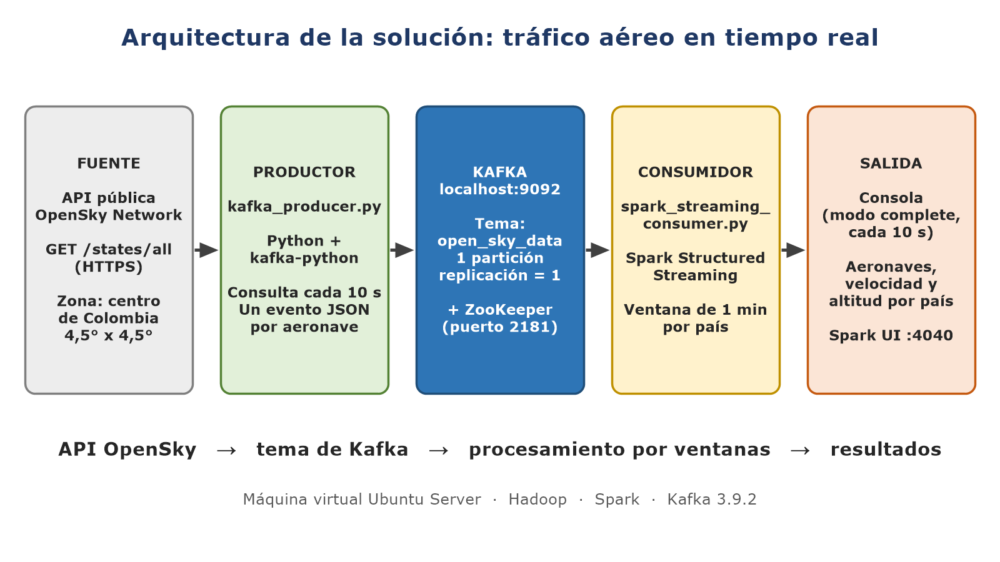
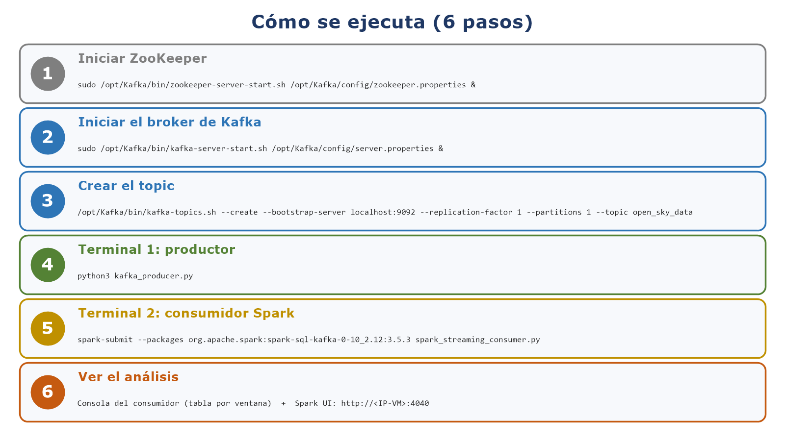
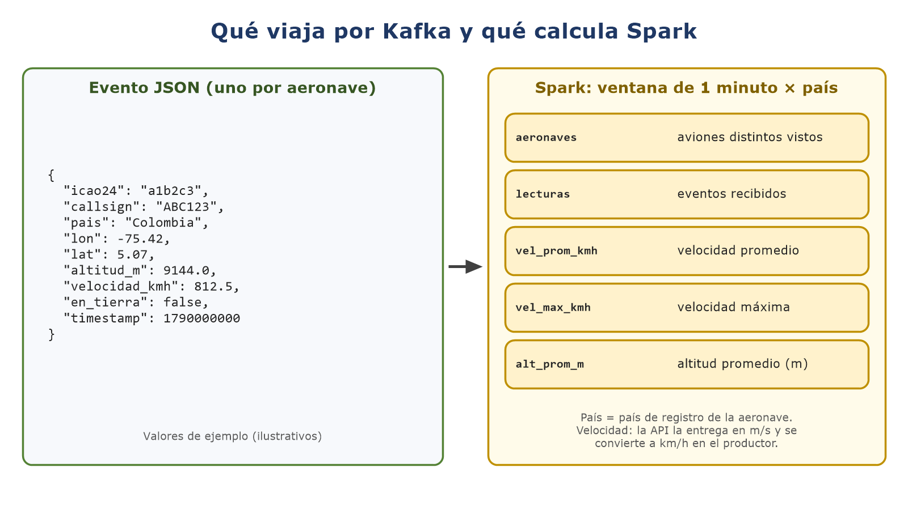

# Tráfico aéreo en tiempo real con Kafka y Spark Structured Streaming

Adaptación del **Anexo 3** del curso Big Data (UNAD, cód. 202016911, Tarea 3 - Procesamiento de Datos con Apache Spark). En lugar de sensores aleatorios, el generador de datos es la **API pública de OpenSky Network**, que reporta en tiempo real la posición de las aeronaves.

- **Productor** (`kafka_producer.py`): consulta la API cada 10 s y publica un evento JSON por aeronave en Kafka.
- **Consumidor** (`spark_streaming_consumer.py`): lee el topic con Spark Structured Streaming y calcula estadísticas por ventana de 1 minuto y país de origen.

## Problema

¿Cómo resumir minuto a minuto el tráfico aéreo del centro de Colombia (Bogotá, Medellín, Cali) cuando los datos llegan de forma continua? El flujo se transporta con Kafka y se analiza con Spark sin esperar a acumular todo el conjunto de datos.

## Arquitectura



```
API OpenSky  →  kafka_producer.py  →  Kafka (topic open_sky_data)  →  spark_streaming_consumer.py  →  consola / Spark UI
```

Configuración de Kafka usada (suficiente para el laboratorio):

| Elemento | Valor |
|---|---|
| Brokers | 1 (`localhost:9092`) |
| Topic | `open_sky_data` |
| Particiones | 1 |
| Factor de replicación | 1 (sin réplicas seguidoras) |
| Coordinación | ZooKeeper (puerto 2181), propio de Kafka 3.9.x |

Con 1 partición no hay lectura en paralelo y con 1 réplica no hay tolerancia a la caída del broker.

## Estructura de archivos

```
.
├── README.md
├── .gitignore
├── kafka_producer.py             # productor: API OpenSky → Kafka
├── spark_streaming_consumer.py   # consumidor: Kafka → Spark → consola
├── Constantes/
│   ├── __init__.py
│   └── constantes.py             # topic, servidor de Kafka y URL de la API
└── img/                          # diagramas usados en este README
```

## Requisitos

- Máquina virtual Ubuntu Server con Hadoop y Spark instalados (la misma de las actividades anteriores).
- Python 3 con las librerías `kafka-python` y `requests`.
- Apache Kafka 3.9.2 en `/opt/Kafka`, con ZooKeeper (instalación según el Anexo 3).
- Spark con el conector de Kafka `spark-sql-kafka-0-10_2.12:3.5.3`. La versión del paquete debe coincidir con la de Spark (se consulta con `spark-submit --version`).
- Acceso a internet desde la VM, para llegar a `opensky-network.org`.

Instalar las librerías de Python (una sola vez):

```bash
pip install kafka-python requests
```

## Configuración

Los parámetros comunes están en [`Constantes/constantes.py`](Constantes/constantes.py) y los usan el productor y el consumidor:

| Constante | Valor | Uso |
|---|---|---|
| `KAFKA_TOPIC_NAME` | `open_sky_data` | Topic donde se publica y desde donde se lee |
| `PORT` | `localhost:9092` | Servidor de Kafka (bootstrap) |
| `API_URL` | `https://opensky-network.org/api/states/all` | Endpoint de OpenSky |

Parámetros propios del productor (al inicio de `kafka_producer.py`):

| Parámetro | Valor | Descripción |
|---|---|---|
| `ZONA` | lat 3,0 a 7,5 · lon -77,5 a -73,0 | Recuadro consultado: centro de Colombia |
| `INTERVALO` | 10 s | Tiempo entre consultas (resolución del acceso anónimo) |

## Ejecución paso a paso



Los scripts se ejecutan desde la carpeta que contiene `Constantes/`.

**1. Iniciar ZooKeeper**

```bash
sudo /opt/Kafka/bin/zookeeper-server-start.sh /opt/Kafka/config/zookeeper.properties &
```

**2. Iniciar el broker de Kafka**

```bash
sudo /opt/Kafka/bin/kafka-server-start.sh /opt/Kafka/config/server.properties &
```

**3. Crear el topic** (solo la primera vez)

```bash
/opt/Kafka/bin/kafka-topics.sh --create --bootstrap-server localhost:9092 --replication-factor 1 --partitions 1 --topic open_sky_data
```

Verificar que existe:

```bash
/opt/Kafka/bin/kafka-topics.sh --list --bootstrap-server localhost:9092
```

**4. (Opcional) Probar la API desde la VM.** Consume 1 crédito de OpenSky.

```bash
curl -s "https://opensky-network.org/api/states/all?lamin=3.0&lomin=-77.5&lamax=7.5&lomax=-73.0" | head -c 400
```

**5. Terminal 1: iniciar el productor**

```bash
python3 kafka_producer.py
```

Cada ciclo imprime cuántos eventos envió, los créditos restantes de la API y un evento de ejemplo.

**6. Terminal 2: iniciar el consumidor**

```bash
spark-submit --packages org.apache.spark:spark-sql-kafka-0-10_2.12:3.5.3 spark_streaming_consumer.py
```

Inicia primero el productor y después el consumidor: el consumidor lee desde los datos más recientes (`startingOffsets=latest`) y necesita al menos un lote nuevo para mostrar resultados.

**7. Ver el análisis.** La tabla aparece en la consola del consumidor y se actualiza cada 10 s. La interfaz de Spark (Jobs, Stages, Environment, Executors) está en `http://<IP-de-la-VM>:4040`.

## Qué hace cada script



### Productor: `kafka_producer.py`

Consulta `GET /states/all` con el recuadro de `ZONA`, descarta las aeronaves sin posición y publica un evento JSON por cada una:

| Campo | Origen en la API | Descripción |
|---|---|---|
| `icao24` | `[0]` | Identificador único de la aeronave |
| `callsign` | `[1]` | Indicativo del vuelo (sin espacios sobrantes) |
| `pais` | `[2] origin_country` | País de registro de la aeronave (no el territorio que sobrevuela) |
| `lon`, `lat` | `[5]`, `[6]` | Posición |
| `altitud_m` | `[7]` | Altitud barométrica en metros (puede ser `null`) |
| `velocidad_kmh` | `[9] × 3,6` | La API entrega m/s; se convierte a km/h (puede ser `null`) |
| `en_tierra` | `[8]` | `true` si la aeronave está en tierra |
| `timestamp` | `time` | Instante de la consulta, en segundos desde 1970 |

Si la red falla o la API devuelve un error, espera 30 s y reintenta. Se detiene con `Ctrl + C`.

### Consumidor: `spark_streaming_consumer.py`

Lee el topic con `readStream`, interpreta el JSON con un esquema explícito y agrupa por **ventana de 1 minuto y país**. La salida se escribe en consola en modo `complete`, cada 10 s:

| Columna | Descripción |
|---|---|
| `window` | Ventana de 1 minuto |
| `pais` | País de registro de la aeronave |
| `aeronaves` | Aeronaves distintas vistas (conteo aproximado, `approx_count_distinct`) |
| `lecturas` | Eventos recibidos (cada aeronave se lee unas 6 veces por minuto) |
| `vel_prom_kmh`, `vel_max_kmh` | Velocidad promedio y máxima |
| `alt_prom_m` | Altitud promedio |

Los promedios ignoran los valores `null`. El resultado se ordena por ventana más reciente y número de aeronaves.

## Límites de la API y modo simulado

- El acceso anónimo de OpenSky permite **400 créditos al día**, con resolución de 10 s.
- Una consulta sobre un área de hasta 25 grados cuadrados cuesta **1 crédito**; las áreas mayores cuestan más. La zona de este proyecto mide 4,5° × 4,5° = 20,25 grados cuadrados.
- Con una consulta cada 10 s se gastan 360 créditos por hora, por lo que el límite diario se agota en poco más de una hora de ejecución continua.
- Para probar Kafka y Spark sin gastar créditos, el productor tiene un modo simulado que genera aeronaves aleatorias con el mismo formato:

```bash
python3 kafka_producer.py --simulado
```

Para la demostración y los resultados reales, ejecútalo sin `--simulado`.

## Solución de problemas

| Síntoma | Causa probable | Solución |
|---|---|---|
| `ModuleNotFoundError: No module named 'Constantes'` | Se ejecutó desde otra carpeta | Entrar a la carpeta que contiene `Constantes/` y ejecutar de nuevo |
| `NoBrokersAvailable` en el productor | Kafka o ZooKeeper no están iniciados | Repetir los pasos 1 y 2 |
| `UnknownTopicOrPartitionException` o el consumidor no encuentra el topic | El topic no existe | Crearlo (paso 3) y verificarlo con `--list` |
| `Limite de la API alcanzado (429)` | Se agotaron los créditos diarios | Esperar al siguiente día o usar `--simulado` |
| El consumidor no muestra filas | Inició antes que el productor, o no ha llegado un lote nuevo | Dejar el productor corriendo y esperar unos segundos |
| Error de Spark al cargar `spark-sql-kafka` | La versión del paquete no coincide con la de Spark | Ajustar el número final de `--packages` a la versión de Spark |

## Detener

`Ctrl + C` en el productor y en el consumidor. Para detener Kafka y ZooKeeper:

```bash
sudo /opt/Kafka/bin/kafka-server-stop.sh
sudo /opt/Kafka/bin/zookeeper-server-stop.sh
```

## Referencias

- OpenSky Network. (s. f.). *The OpenSky Network API 1.4.0 documentation: REST API*. https://openskynetwork.github.io/opensky-api/rest.html
- Schäfer, M., Strohmeier, M., Lenders, V., Martinovic, I., & Wilhelm, M. (2014). Bringing up OpenSky: A large-scale ADS-B sensor network for research. *Proceedings of the 13th International Symposium on Information Processing in Sensor Networks (IPSN 2014)*, 83-94. https://doi.org/10.1109/IPSN.2014.6846743
- Apache Kafka. (2026). *Introduction*. https://kafka.apache.org/intro
- Apache Spark. (2026). *Structured Streaming programming guide*. https://spark.apache.org/docs/latest/streaming/getting-started.html
- Universidad Nacional Abierta y a Distancia. *Anexo 3. Instructivo Spark Streaming y Kafka* (curso Big Data).

## Autoría

Osmar Junior Lara Valdez · Grupo 20 · Big Data (202016911) · UNAD · octubre de 2026
